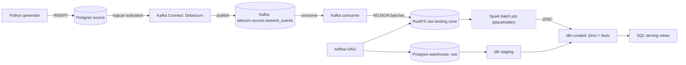

# Telecom Network Analytics

An end-to-end data platform for a mobile network operator. It answers two questions:

1. **Which cell sites and regions deliver a degraded quality of experience** — dropped or
   failed calls, low throughput, high latency, weak signal?
2. **Which subscribers show early churn signals** — falling usage after a poor network
   experience — so Retention can act before they leave?

Built incrementally, phase by phase. This delivery is **Phase 1: Walking Skeleton — the
first end-to-end batch pipeline**, built on the Phase 0 infrastructure skeleton. The full
problem statement, data model, pipeline design, data-quality plan and phase roadmap are in
[`docs/PROJECT_PLAN.md`](docs/PROJECT_PLAN.md).

## Architecture



**Implemented vs. planned:** every node above is real and orchestrated by the DAG. The
dashed node, `Spark batch job`, is wired into the DAG (`spark_batch_cell_hourly_kpi` task,
reads its CLI args, logs, then raises `NotImplementedError`) but its aggregation logic
ships in Phase 3 — see "Current Status" below. Everything else is fully implemented.

**Component roles** (condensed; full walkthrough with rationale for each choice:
[`docs/PROJECT_PLAN.md`](docs/PROJECT_PLAN.md), section 3):

| Component | Role in this pipeline |
|---|---|
| Python generator | Only component that invents data; writes into `source.network_events` |
| Postgres (source) | Stands in for a real network-probe collector's database |
| Kafka Connect + Debezium | **Ingestion**: reads the source WAL, publishes every insert to Kafka — no app code |
| Kafka | Durable, replayable buffer between CDC and the storage writer |
| Kafka consumer | Batches Kafka messages into NDJSON objects in RustFS, idempotent by offset range |
| RustFS | **Raw landing zone** — S3-compatible object storage, the data lake layer |
| Postgres warehouse — `raw` | Warehouse copy of the raw data, loaded by the DAG so dbt can transform it |
| dbt staging | **Staging**: 1:1 typed views over `raw`, DQ flags, bad rows flagged not dropped |
| dbt curated | **Curated**: dimension/fact tables the business actually queries |
| Spark batch job | Reads RustFS directly, writes one aggregate to `curated` over JDBC (placeholder) |
| Airflow | **Orchestration**: sequences every task above, owns retries and failure handling |
| SQL serving views | **Serving**: plain SQL over `curated`, queryable by any SQL client — no extra service |

## Tech Stack

| Layer | Technology |
|---|---|
| Source database | PostgreSQL 16.4 (`wal_level=logical`) |
| Change data capture | Kafka Connect + Debezium PostgreSQL connector 2.7.3 |
| Streaming backbone | Apache Kafka 3.8.0 (KRaft mode) |
| Kafka observability | Kafka UI (Provectus) 0.7.2 |
| Raw object storage | RustFS 1.0.0 (S3-compatible) |
| Warehouse | PostgreSQL 16.4 (separate instance) |
| Transformation (dims/facts) | dbt-core 1.8.7 / dbt-postgres 1.8.2 |
| Batch processing (aggregates) | Apache Spark 3.5.3 (standalone master + worker) |
| Orchestration | Apache Airflow 2.10.2 |
| Containerisation | Docker Compose |

Justification and rejected alternatives for every choice: `docs/PROJECT_PLAN.md`, section 4.

## Prerequisites

- Docker with Compose v2
- Python 3.10+ with the `venv` module (Debian/Ubuntu: `sudo apt install python3-venv`) and GNU Make
- About 6 GB of free RAM (the idle stack measures ≈ 3.3 GB) for the local stack (3× Postgres, Kafka, Kafka Connect,
  Kafka UI, RustFS, Spark master + worker, Airflow webserver + scheduler)
- Free host ports: 5432, 5433, 7077, 8080, 8081, 8083, 8085, 9000, 9001, 9092
  (all are bound to `127.0.0.1` only)

## Setup

```bash
git clone https://github.com/orhanahmadov/telecom-network-analytics.git
cd telecom-network-analytics

make init-env      # creates .env with freshly generated secrets (git-ignored)
make up            # builds the Airflow image and starts every service
make ps            # wait until all services are "healthy"
```

`make init-env` is `python3 scripts/init_env.py`: it copies `.env.example` to `.env` and
replaces every `CHANGE_ME` with a random value (including a valid Fernet key and Kafka
cluster id). `make up` runs it automatically if `.env` does not exist yet.

Service endpoints once the stack is up:

| Service | URL / address | Credentials |
|---|---|---|
| Airflow | http://localhost:8080 | `AIRFLOW_ADMIN_USER` / `AIRFLOW_ADMIN_PASSWORD` from `.env` |
| RustFS console | http://localhost:9001 | `RUSTFS_ACCESS_KEY` / `RUSTFS_SECRET_KEY` from `.env` |
| Spark master UI | http://localhost:8081 | — |
| Kafka UI | http://localhost:8085 | — |
| Kafka Connect REST | http://localhost:8083 | — |
| Postgres (source) | `localhost:5433`, database `SOURCE_POSTGRES_DB` | `SOURCE_POSTGRES_USER` / `SOURCE_POSTGRES_PASSWORD` |
| Postgres (warehouse) | `localhost:5432`, database `POSTGRES_DB` | `POSTGRES_USER` / `POSTGRES_PASSWORD` |
| Kafka broker | `localhost:9092` | — |

**Expected state:** every service shows `healthy`, except `airflow-init`, which is a
one-shot container and correctly shows `Exited (0)`.

### Python environment (generator, consumer, tests)

```bash
make venv          # creates .venv and installs pinned requirements-dev.txt
make test          # runs the test suite (no Docker needed)
```

### Try the ingestion skeleton

```bash
make register-connector          # register the Debezium connector (idempotent)
make generate COUNT=50           # write 50 synthetic events into the source Postgres
make consume BATCH_SIZE=50       # land them in RustFS; Ctrl+C after the first batch
make dbt-debug                   # dbt (inside Airflow) can connect to the warehouse
make smoke                       # infra wiring + a row count for every layer (source -> raw -> staging -> curated -> serving)
```

## Run the Pipeline

The steps above land a handful of events for a quick sanity check. This section is the
full, real run: generate a non-trivial batch, carry it through every layer with the
orchestrator, prove a deliberate failure is handled correctly, and verify each layer by
hand. Every command below is exactly what a reviewer runs, with nothing done by hand
outside of these commands.

### 1. Generate and land a real batch

```bash
make register-connector          # idempotent; safe to re-run
make generate COUNT=1500         # >=1000 rows, satisfying the Phase 1 volume requirement
make consume                     # drains the topic into RustFS NDJSON batches; Ctrl+C once
                                  # it stops logging new flushes (a few seconds after `generate` finishes)
```

The consumer partitions every object by the hour it was **ingested**
(`raw/network_events/dt=<YYYY-MM-DD>/hr=<HH>/...`), so the logical date for this batch is
whatever date you ran this step on (shown in the consumer's log lines).

### 2. Trigger the DAG for that logical date

Open Airflow at http://localhost:8080 (`AIRFLOW_ADMIN_USER` / `AIRFLOW_ADMIN_PASSWORD`
from `.env`), find `telecom_pipeline`, unpause it, then **Trigger DAG w/ config**:

```json
{"force_failure": "none"}
```

Leave the logical date at its default (today) if you just ran step 1 for today, or pick
the date you generated data for. From the CLI instead:

```bash
docker compose -f infra/docker-compose.yml --env-file .env exec airflow-scheduler   airflow dags trigger telecom_pipeline -e 2026-10-14 -c '{"force_failure": "none"}'
```

(replace `2026-10-14` with the logical date). Watch the Graph view:
`load_raw_to_postgres -> dbt_run_staging -> dbt_test_staging -> dbt_run_curated ->
dbt_test_curated -> dbt_run_serving -> dbt_test_serving` should all turn green.
`spark_batch_cell_hourly_kpi` is a Phase 3 placeholder and is expected to fail/retry — it
has no downstream dependents, so it never blocks the rest of the graph.

### 3. Trigger a deliberate failure

Trigger again, same dialog, with:

```json
{"force_failure": "load_raw_to_postgres"}
```

`load_raw_to_postgres` raises before touching any data, retries twice with a 2-minute
delay, then fails — every downstream task is correctly left `upstream_failed` rather than
running against incomplete data. Screenshots and the exact log line are in
[`docs/evidence/phase-1.md`](docs/evidence/phase-1.md), section 5. Re-trigger with
`{"force_failure": "none"}` afterwards to confirm a normal run still succeeds for the same
logical date (also idempotent — see step 4).

### 4. Verify every layer by hand

```bash
docker compose -f infra/docker-compose.yml --env-file .env exec postgres   psql -U "$POSTGRES_USER" -d "$POSTGRES_DB" -c "
    select 'raw.network_events' as table_name, count(*) from raw.network_events
    union all select 'staging.stg_network_events_valid', count(*) from staging.stg_network_events_valid
    union all select 'staging.stg_network_events_rejected', count(*) from staging.stg_network_events_rejected
    union all select 'curated.dim_cell_site', count(*) from curated.dim_cell_site
    union all select 'curated.dim_subscriber', count(*) from curated.dim_subscriber
    union all select 'curated.fct_voice_call', count(*) from curated.fct_voice_call
    union all select 'curated.fct_data_session', count(*) from curated.fct_data_session
    union all select 'serving.vw_cell_quality_ranking', count(*) from serving.vw_cell_quality_ranking
    union all select 'serving.vw_subscriber_churn_signals', count(*) from serving.vw_subscriber_churn_signals;
  "
```

Or skip the hand-written SQL — `make smoke` runs exactly this (plus the infra-wiring
checks) in one command:

```bash
make smoke
```

**Expected result:** every layer reports non-zero rows for the logical date you ran;
`staging valid + staging rejected` equals the `raw` count exactly (every raw row is
either published or flagged, nothing silently dropped); re-running step 2 for the same
logical date changes none of these counts. A real run's numbers, with screenshots, are in
[`docs/evidence/phase-1.md`](docs/evidence/phase-1.md).

## Stopping and Restarting

```bash
make down      # stop; state is kept in named Docker volumes
make up        # start again: Postgres data, Kafka log and RustFS objects survive
make clean     # full reset: stops everything and DELETES all volumes
```

Without Make, use `docker compose -f infra/docker-compose.yml --env-file .env <command>`.

## Project Structure

```
.
├── .github/
│   └── workflows/ci.yml                # lint, format, compile-check, test, docker-compose validation
├── docs/
│   ├── PROJECT_PLAN.md                 # problem, sources, architecture, model, DQ, roadmap, risks
│   └── decisions/                      # ADRs for significant design choices
├── infra/
│   ├── docker-compose.yml              # every service, pinned images, healthchecks, named volumes
│   ├── airflow/Dockerfile              # Airflow image + dbt in an isolated virtualenv
│   ├── postgres/init.sql               # warehouse: raw/staging/curated/serving schemas + raw.network_events
│   ├── postgres-source/init.sql        # source: source.network_events table watched by Debezium
│   └── kafka-connect/
│       ├── postgres-source-connector.json   # Debezium connector configuration
│       └── register_connector.py            # registers/updates the connector via REST (idempotent)
├── ingestion/
│   ├── schemas.py                      # dataclasses: Subscriber, CellSite, NetworkEvent
│   ├── producer/
│   │   ├── generator.py                # synthetic events: stable population, degraded cells, dirty data, drift
│   │   └── db_writer.py                # CLI: writes generated events into source.network_events
│   ├── consumer/
│   │   └── kafka_to_rustfs.py          # CLI: consumes the CDC topic, lands NDJSON batches in RustFS
│   └── loader/
│       └── raw_loader.py               # CLI: loads one day's RustFS objects into raw.network_events
├── orchestration/
│   └── dags/telecom_pipeline_dag.py    # Airflow DAG (load_raw_to_postgres -> dbt staging/curated + Spark)
├── transformation/
│   ├── dbt_telecom/                    # dbt project: staging (DQ flags) + curated model + serving views
│   └── spark_jobs/
│       └── cell_hourly_kpi_batch.py    # Spark job skeleton: RustFS -> agg_cell_hourly_kpi
├── config/
│   └── settings.py                     # single source of truth for all configuration
├── scripts/
│   ├── init_env.py                     # generates .env with random secrets from .env.example
│   └── smoke_check.py                  # checks the stack is wired + reports a row count per layer, source->serving
├── tests/                              # unit + contract tests (see below)
├── .env.example                        # every required variable, documented
├── ruff.toml                           # narrow lint/format rule set used by `make lint` and CI
├── requirements.txt                    # pinned runtime dependencies (host-side tools)
├── requirements-dev.txt                # + pytest, dbt, ruff (pinned)
└── Makefile                            # one-word entry points for everything above
```

Every top-level directory maps to a stage of the architecture diagram: `ingestion` =
source and ingestion, `infra` = storage/warehouse and supporting services,
`transformation` = dbt and Spark, `orchestration` = scheduling, `config` = central
configuration, `tests` = automated checks, `docs` = planning and design.

### Tests

`make test` runs 85+ tests without Docker. Besides unit tests they include **contract
tests** that keep the pieces consistent: every `${VAR}` in `docker-compose.yml` and every
variable read by `config/settings.py` must appear in `.env.example`; the columns the
writer inserts must match the source DDL; the raw table must mirror the source table;
all image tags must be pinned; every long-running service must have a healthcheck; host
ports must be loopback-only; the connector topic must match the configured topic.

### Continuous Integration

Every pull request (and every push to `main`) runs three independent GitHub Actions jobs
([`.github/workflows/ci.yml`](.github/workflows/ci.yml)):

| Job | What it checks | Same as running locally |
|---|---|---|
| `lint-and-format` | `ruff check` (syntax errors, unused imports) and `ruff format --check` | `make lint` / `make format-check` |
| `compile-check` | Every module under `config/`, `ingestion/`, `orchestration/`, `scripts/`, `transformation/`, `tests/` byte-compiles, then the full test suite runs | `make compile-check` / `make test` |
| `compose-validate` | `infra/docker-compose.yml` is syntactically valid and every variable it references resolves | `make compose-validate` |

`make lint` and `make format-check` use the rule set in [`ruff.toml`](ruff.toml) —
deliberately narrow (syntax errors and unused imports only; no import-sorting or
docstring rules), since this project does not enforce a broader style guide. Running the
full integration smoke test (`make smoke`) in CI is intentionally out of scope for Phase 1
(see `docs/PROJECT_PLAN.md`): it needs the whole stack running, which does not fit a
lightweight PR-gate runner.

`main` is a protected branch: every change arrives through a pull request, and the branch
cannot be updated directly (including by the repository owner) — see
`docs/PROJECT_PLAN.md` for the branching workflow.

## Current Status — Phase 1

**Delivered**

- Docker Compose brings up source Postgres (CDC-enabled), warehouse Postgres, Airflow's
  metadata Postgres, Kafka (KRaft), Kafka Connect (Debezium), Kafka UI, RustFS, Spark
  (master + worker) and Airflow (webserver + scheduler), with pinned image versions,
  healthchecks and persistent named volumes.
- `raw` / `staging` / `curated` / `serving` schemas and the `raw.network_events` table are
  created in the warehouse, and `source.network_events` in the source database, on first
  boot.
- Ingestion: a synthetic generator (stable subscriber and cell population, hidden degraded
  cells, configurable dirty-record and schema-drift rates), a Postgres writer CLI, and a
  Kafka-to-RustFS consumer CLI — runnable and unit-tested. The Debezium connector is
  registered with one command (`make register-connector`).
- Raw loading: `ingestion/loader/raw_loader.py` loads one logical date's RustFS objects
  into `raw.network_events`, idempotently at both the object level (`raw._loaded_objects`)
  and the row level (`ON CONFLICT (event_id) DO NOTHING`), wired into the DAG's
  `load_raw_to_postgres` task.
- Orchestration: one Airflow DAG with the full task graph, created paused, every task
  retrying twice with a 2-minute delay. A `force_failure` DAG param deliberately fails
  `load_raw_to_postgres` before it touches any data, to prove retries/alerting work and
  that a failed run leaves no partial state. Tasks log structured `event=...` lines.
  `dbt_test_staging` / `dbt_test_curated` are blocking DQ gates — a `dbt test` failure
  fails the task and leaves every downstream dbt task `upstream_failed`, so bad data never
  reaches `curated` or `serving`.
- Transformation: a dbt project with real `staging` models (typed casts, `dq_flags`,
  `stg_network_events_valid` / `_rejected`) and a real `curated` dimensional model
  (`dim_cell_site`, `dim_subscriber` SCD2, `fct_voice_call`, `fct_data_session`), covered
  by 15 dbt data tests (not_null, unique, accepted_values, relationships). A Spark job
  skeleton with a working CLI is still a placeholder (Phase 3).
- Serving: two `serving` views on top of `curated` — `vw_cell_quality_ranking` (answers
  the Network Operations question: cells ranked by a composite drop-rate/latency/
  throughput score over a trailing 7-day window) and `vw_subscriber_churn_signals`
  (answers the Retention question: subscribers flagged on a usage drop plus
  poor-experience events over a trailing 14-day window), covered by 5 more dbt data
  tests. Heuristic thresholds and weights are initial assumptions — see
  `docs/decisions/0002-serving-layer-heuristics.md`.
- `make smoke` proves the pipeline end to end in one command: infra wiring (connector,
  topic, object store, warehouse schemas) plus a row count for every layer, source
  through serving — the fastest way to answer "did the whole pipeline actually run?".
- One-command secret generation (`make init-env`), pinned dependencies, and a CI gate
  (lint, compile-check, compose validation) on every pull request.
- Architecture decision records for significant design choices live in `docs/decisions/`.

**Not implemented yet (by design; scheduled in `docs/PROJECT_PLAN.md`, section 8)**

The Spark aggregation and the hourly schedule (Phase 3), the remaining data quality
checks — `dq_summary` view, freshness, reconciliation, failure alerting (Phase 4; checks
1/6/7 already gate the DAG as of Phase 1) — and the branching/CI workflow (Phase 6 —
branch protection and PR-based CI are already in place ahead of schedule; what remains
there is the rest of that phase's documentation pass).

The generator does not yet simulate subscriber plan migrations, so `dim_subscriber`'s
SCD Type 2 logic is implemented and tested but currently produces exactly one version per
subscriber — see `docs/decisions/0001-derive-dim-subscriber-scd2-from-event-stream.md`.

## Troubleshooting

- **A port is already in use** (commonly 5432 or 8080): stop the local service using it,
  or change the left-hand side of the port mapping in `infra/docker-compose.yml`.
- **A service is `unhealthy`:** `docker compose -f infra/docker-compose.yml --env-file .env logs <service>`.
- **RustFS reports permission denied on `/data`:** the volume was created with different
  ownership; run `make clean` and `make up` to recreate it.
- **`make up` after regenerating `.env` fails on Postgres login:** the existing volumes
  keep the *old* passwords. Run `make clean` first, then `make init-env` and `make up`.
- **`raw._loaded_objects does not exist` (or any other new warehouse table/column):**
  `infra/postgres/init.sql` only runs once, on an empty volume. Run `make clean && make up`
  to pick up a schema change made after your first `make up`.
- **Docker runs out of memory:** raise Docker's memory limit to at least 6 GB, or stop
  `kafka-ui` (it is not part of the data path).


## Acknowledgements

The initial repository layout and the Docker Compose service set were modelled on the
example project `gaming-data-pipeline-e2e`, used as a structural reference for how the
assignment's required layout (ingestion / transformation / orchestration / config / infra
/ tests / docs) could be organized. Ingestion, the raw-lake partitioning, the Debezium
envelope handling, the data model, the project plan, the tests and the `make smoke`
tooling were written and adapted for this telecom use case.
