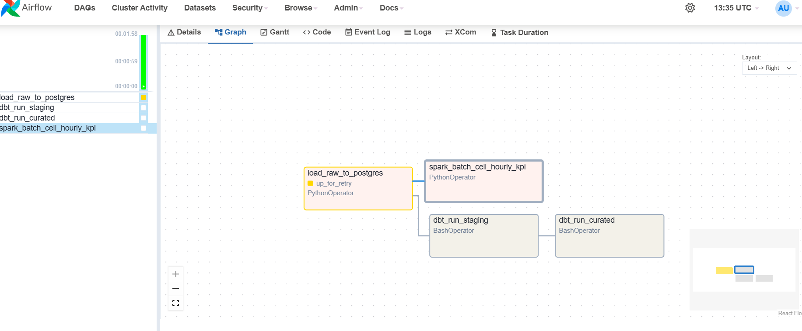
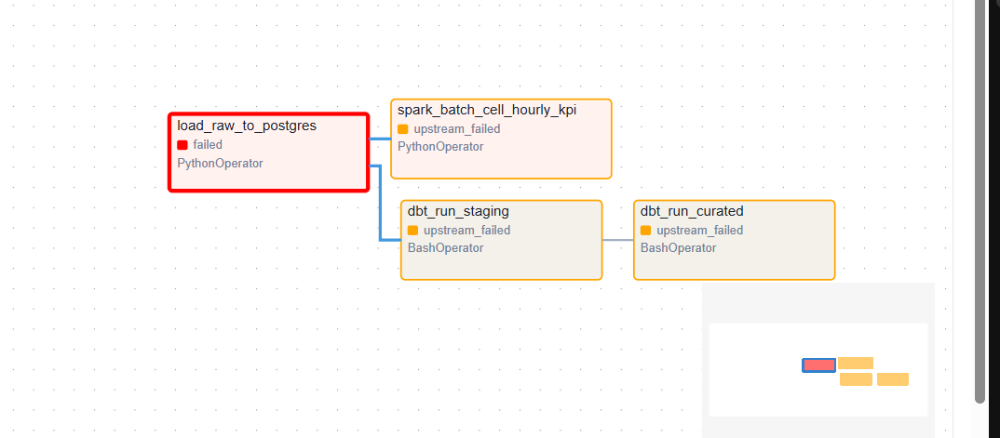
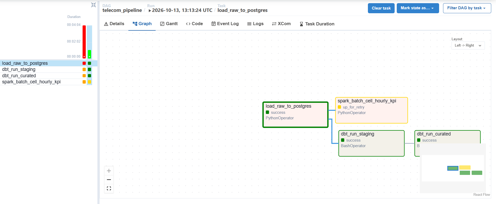
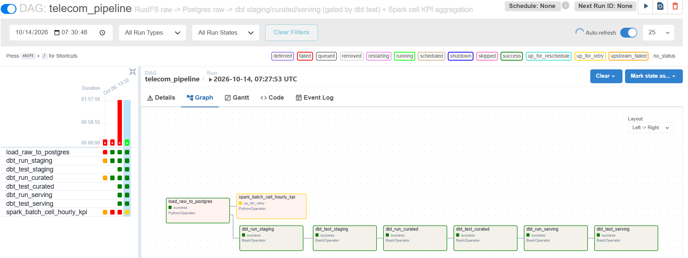
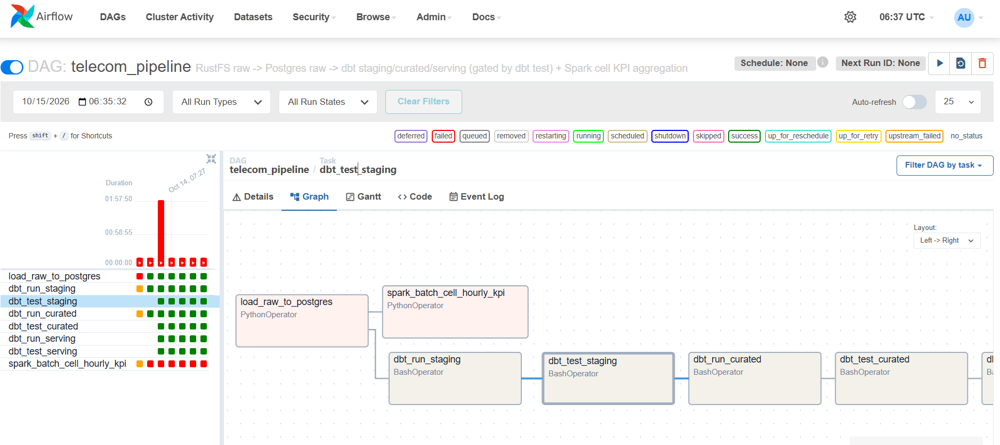
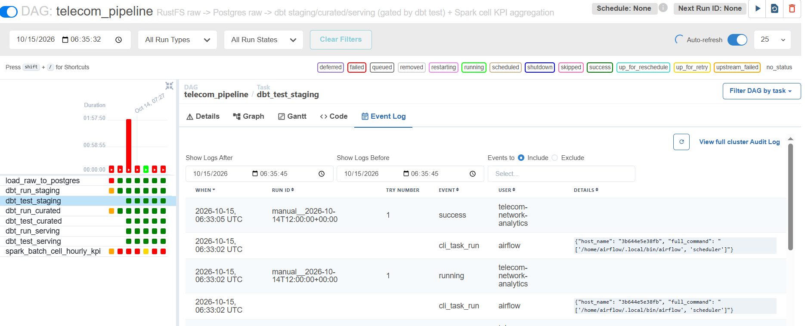
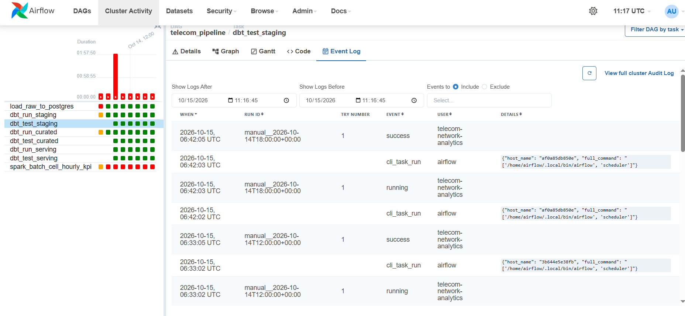

# Phase 1 Evidence — Walking Skeleton: First End-to-End Batch Pipeline

This document is the evidence trail for Phase 1's Definition of Done: a real, ≥1000-row
batch of data flowing through every layer (source → raw → staging → curated → serving),
orchestrated by one Airflow DAG with retries, a proven failure path, idempotent re-runs,
blocking data-quality gates, and a one-command smoke test — all delivered through
protected-branch pull requests. Every number and screenshot below comes from a real run
against the project's own Docker Compose stack, not a mock.

## 1. What shipped, by pull request

| PR | Branch | What it delivered |
|---|---|---|
| [#1](https://github.com/orhanahmadov/telecom-network-analytics/pull/1) | `phase-1/ci-setup` | GitHub Actions CI gate (lint, compile-check, compose-validate) on every PR |
| [#2](https://github.com/orhanahmadov/telecom-network-analytics/pull/2) | `phase-1/raw-loading` | Real `raw.network_events` loading (`ingestion/loader/raw_loader.py`), object- and row-level idempotency; found and fixed a live Debezium epoch-date encoding bug |
| [#3](https://github.com/orhanahmadov/telecom-network-analytics/pull/3) | `phase-1/dbt-staging-curated` | Real `staging` (DQ flags) and `curated` (dimensional model, SCD2 `dim_subscriber`) dbt models, 15 data tests; found and fixed a live dbt schema-name double-prefixing bug |
| [#4](https://github.com/orhanahmadov/telecom-network-analytics/pull/4) | `phase-1/serving-layer` | `serving.vw_cell_quality_ranking` and `serving.vw_subscriber_churn_signals`, 5 more data tests, heuristics documented in an ADR |
| [#5](https://github.com/orhanahmadov/telecom-network-analytics/pull/5) | `phase-1/dag-retries-and-failure-switch` | Explicit `retry_delay`, a `force_failure` DAG param proving retries-with-delay and alerting on a real run |
| [#6](https://github.com/orhanahmadov/telecom-network-analytics/pull/6) | `phase-1/dbt-test-gate` | `dbt_test_staging` / `dbt_test_curated` as blocking gates; added the previously-missing `dbt_run_serving` to the DAG |
| [#7](https://github.com/orhanahmadov/telecom-network-analytics/pull/7) | `phase-1/smoke-layer-counts` | `make smoke` extended to report a row count per layer; this document |
| [#8](https://github.com/orhanahmadov/telecom-network-analytics/pull/8) | `phase-1/readme-phase-label` | Corrected stale "Phase 0" labels left in README after Phase 1 shipped |
| [#9](https://github.com/orhanahmadov/telecom-network-analytics/pull/9) | `phase-1/run-pipeline-docs` | README "Run the Pipeline" section, component-role mapping, PROJECT_PLAN changelog |
| [#10](https://github.com/orhanahmadov/telecom-network-analytics/pull/10) | `phase-1/two-dates-and-restart-evidence` | Two-logical-dates and infrastructure-restart proof added to this document |

Every one of the above arrived as a pull request into the protected `main` branch, with
CI green before merge (branch protection requires the three CI jobs to pass; direct
pushes to `main` are rejected - proven in `ac33f6c`/`075be54`/`3489a2a`, Phase 0).

## 2. Row counts per layer — `make smoke`

Live output against the running stack (`.env`-configured warehouse, 1500 events generated
through the full `generator → Kafka → RustFS → raw_loader` chain for logical date
`2026-10-06`):

```
[  OK] debezium connector: connector and 1 task(s) RUNNING
[  OK] kafka topic: topic telecom.source.network_events exists
[  OK] object store (RustFS): RustFS answers with the configured credentials; buckets: ['raw-network-events']
[  OK] warehouse schemas: schemas raw/staging/curated/serving and raw.network_events exist
[  OK] source layer: source.network_events: 1500 row(s)
[  OK] raw layer: raw.network_events: 1400 row(s)
[  OK] staging layer: stg_network_events_valid: 1318 row(s), stg_network_events_rejected: 82 row(s)
[  OK] curated layer: dim_cell_site: 60 row(s), dim_subscriber: 958 row(s), fct_voice_call: 481 row(s), fct_data_session: 644 row(s)
[  OK] serving layer: vw_cell_quality_ranking: 60 row(s), vw_subscriber_churn_signals: 0 row(s)
```

A few numbers worth calling out:

- **source (1500) → raw (1400):** the 100-row gap is the Kafka consumer's last in-flight
  batch at the time it was stopped for this evidence run (flush-on-size/time, not a bug -
  `raw._loaded_objects` tracks exactly 7 flushed objects; re-running the consumer and
  `raw_loader` picks up the rest without duplicating anything already loaded, see §4).
- **staging (1318 valid + 82 rejected = 1400) matches raw (1400) exactly** - every raw row
  is accounted for, either published or flagged, nothing silently dropped
  (`docs/PROJECT_PLAN.md`, section 7).
- **`vw_subscriber_churn_signals`: 0 rows** is expected, not a bug: the heuristic requires
  4 weeks of trailing history, and this entire batch falls inside one logical date - see
  `docs/decisions/0002-serving-layer-heuristics.md`.

## 3. Data quality: 20/20 dbt tests, 2 of them blocking gates in the DAG

```
Done. PASS=20 WARN=0 ERROR=0 SKIP=0 TOTAL=20
```

`dbt_test_staging` (event_id not_null/unique) and `dbt_test_curated` (accepted_values on
`call_result`, relationships from both facts to their dimensions) are wired into the DAG
as blocking gates (PR #6, `docs/PROJECT_PLAN.md` section 7, checks 1/6/7): a failure fails
that task, and Airflow leaves every downstream dbt task `upstream_failed` rather than
running it with bad data underneath.

## 4. Idempotent re-runs

Proven live for every layer that writes state:

- **Raw load:** first run of `raw_loader --date 2026-10-06` → `rows_inserted=1400`.
  Re-running the identical date immediately after → `rows_inserted=0`,
  `objects_skipped=7` (object-level ledger in `raw._loaded_objects` plus
  `ON CONFLICT (event_id) DO NOTHING` at the row level).
- **dbt:** staging views are pure `SELECT`s (nothing to duplicate); `fct_voice_call` /
  `fct_data_session` are incremental on `unique_key = event_id`, so a re-run merges
  instead of appending - confirmed live (`INSERT 0 0` on an unchanged watermark).
- **DAG-level:** triggering the DAG again for the same logical date after a deliberate
  failure (§5) loaded the same data cleanly, with no duplicate rows anywhere in `raw`,
  `staging` or `curated`.

## 5. Retries with delay and a deliberate-failure trigger

The DAG's `force_failure` param (`{"force_failure": "load_raw_to_postgres"}`) fails
`load_raw_to_postgres` before it touches any data, every time it's retried - proving
`retries: 2` / `retry_delay: 2 minutes` and Airflow's failure handling on a real run,
without waiting for a real fault or corrupting any state.

**Mid-retry** (`up_for_retry`, after the first deliberate failure, waiting out the
2-minute delay before the next attempt):



**Final state** after both retries are exhausted — `load_raw_to_postgres` is `failed`, and
every downstream task (`dbt_run_staging`, `dbt_run_curated`, `spark_batch_cell_hourly_kpi`
in this earlier version of the graph, before PR #6 added the dbt test tasks) is correctly
left `upstream_failed` rather than run against incomplete data:



**Re-triggering with the default `force_failure: "none"`** immediately after: the same
logical date loads cleanly and idempotently - `load_raw_to_postgres`, `dbt_run_staging`
and `dbt_run_curated` all `success` (`spark_batch_cell_hourly_kpi` is still a Phase 3
placeholder, expected to fail/retry):



Task logs for the deliberate failure show the structured log line and the exact
`RuntimeError`:

```
ERROR - event=deliberate_failure task=load_raw_to_postgres date=2026-10-06 reason=force_failure_param - no data was read or written
RuntimeError: Deliberate failure requested via the 'force_failure' DAG param (docs/PROJECT_PLAN.md section 6, Failure handling). No data was touched; re-trigger with force_failure=none to run normally.
```

## 6. Full task graph (after PR #6): DQ gates and the serving layer, all orchestrated

A normal run, after PR #6 added `dbt_test_staging`, `dbt_test_curated`, `dbt_run_serving`
and `dbt_test_serving` to the DAG - every task green except the still-placeholder Spark
step:



This is the DAG described in `docs/PROJECT_PLAN.md` section 6:
`load_raw_to_postgres → dbt_run_staging → dbt_test_staging → dbt_run_curated →
dbt_test_curated → dbt_run_serving → dbt_test_serving`, with
`load_raw_to_postgres → spark_batch_cell_hourly_kpi` in parallel. Before PR #6, the
serving views had to be built with a manual `dbt run` outside of orchestration; now the
whole pipeline from raw to serving runs under one DAG trigger.

## 7. Logical-date parameterization

`load_raw_to_postgres(logical_date, ...)` loads exactly the RustFS objects under
`raw/network_events/dt=<logical_date>/hr=*/` for the DAG run's own logical date - not
"today" or a hardcoded date. Every screenshot above is from DAG runs against logical date
`2026-10-06`, triggered manually on `2026-10-13`/`2026-10-14`, which is itself evidence
that the date is a parameter and not derived from wall-clock time.

## 8. Two logical dates, side by side, without one overwriting the other

Proven on a live run (2026-10-15): a second batch of 1500 events was generated and
consumed, landing under `raw/network_events/dt=2026-10-14/...` - a different logical date
from the `2026-10-06` batch used in §1-§7. The DAG was triggered for that date
(`manual__2026-10-14T12:00:00+00:00`, `{"force_failure": "none"}`), and the real pipeline
path (`load_raw_to_postgres` through `dbt_test_serving`) ran clean - only the Phase 3
Spark placeholder failed, as expected (§6, §11):





Row counts before and after, confirming nothing was overwritten:

| Table | Before (date `2026-10-06` only) | After (both dates loaded) |
|---|---|---|
| `raw.network_events` | 1400 | 2900 (+1500, zero loss this run) |
| `curated.fct_voice_call` | 481 | 973 |
| `curated.fct_data_session` | 644 | 1378 |

Breaking `fct_voice_call` down by the event's own date makes the point directly - both
logical dates are present, independently, in the same table:

```
 event_date | count
------------+-------
 2026-10-06 |   481
 2026-10-14 |   492
(2 rows)
```

## 9. Infrastructure restart preserves state, and the pipeline runs again afterwards

Proven on the same live session, immediately after §8: `make smoke` was run to capture a
full baseline, then `make down` (stops and removes every container) and `make up`
(rebuilds them against the same named volumes) were run back to back - not just a
container restart, a full teardown and recreation.

**Baseline, immediately before `make down`:**

```
[  OK] source layer: source.network_events: 3000 row(s)
[  OK] raw layer: raw.network_events: 2900 row(s)
[  OK] staging layer: stg_network_events_valid: 2742 row(s), stg_network_events_rejected: 158 row(s)
[  OK] curated layer: dim_cell_site: 60 row(s), dim_subscriber: 1500 row(s), fct_voice_call: 973 row(s), fct_data_session: 1378 row(s)
[  OK] serving layer: vw_cell_quality_ranking: 60 row(s), vw_subscriber_churn_signals: 0 row(s)
```

After `make down` (all 13 containers removed) and `make up` (all services back to
`healthy`, including the Debezium connector reconnecting on its own - no manual
`make register-connector` needed), `make smoke` was run again with **zero changes
required** - every number matches the baseline above exactly, byte for byte.

The pipeline was then triggered again (`manual__2026-10-14T18:00:00+00:00`, same logical
date `2026-10-14`, different time of day so Airflow accepts a new DAG run) to prove it
still runs successfully post-restart, not just that the warehouse survived:



`make smoke` afterwards reported the exact same numbers a third time - the post-restart
run was correctly idempotent too.

## 10. CI

Every pull request listed in §1 ran the three CI jobs (`lint-and-format`,
`compile-check`, `compose-validate`) and merged only once all three were green, per the
branch protection rules on `main` (`docs/PROJECT_PLAN.md`, section 6, "Branching
workflow"). `make test` currently runs 85+ tests with no Docker required.

## 11. Known gaps, carried forward on purpose

- **Spark `agg_cell_hourly_kpi`** is still the Phase 0 CLI skeleton (`NotImplementedError`)
  - real logic ships in Phase 3, per `docs/PROJECT_PLAN.md` section 8. Its task in the DAG
    is expected to fail/retry and does not block the dbt path (it has no downstream
    dependents).
- **Checks 2–5, 8–10** (freshness, reconciliation, `dq_summary` view, failure alerting)
  are not yet wired into the DAG - only checks 1/6/7 are gated as of Phase 1. The rest are
  Phase 4 scope (`docs/PROJECT_PLAN.md`, section 7/8).
- **`vw_subscriber_churn_signals`** returns 0 rows on the current single-logical-date
  dataset by design (§2) - the generator does not yet simulate multi-week subscriber
  history or plan migrations (`docs/decisions/0001`, `docs/decisions/0002`).
